# Emberwell

*A jetpack cave explorer made with [BlockBoy Game Foundry](https://github.com/icakinser/Blockboy-Game-Foundry), a block-based game engine.* This repo holds the playable game, its cartridge, and a step-by-step tutorial that rebuilds it from an empty cartridge.

<p align="center">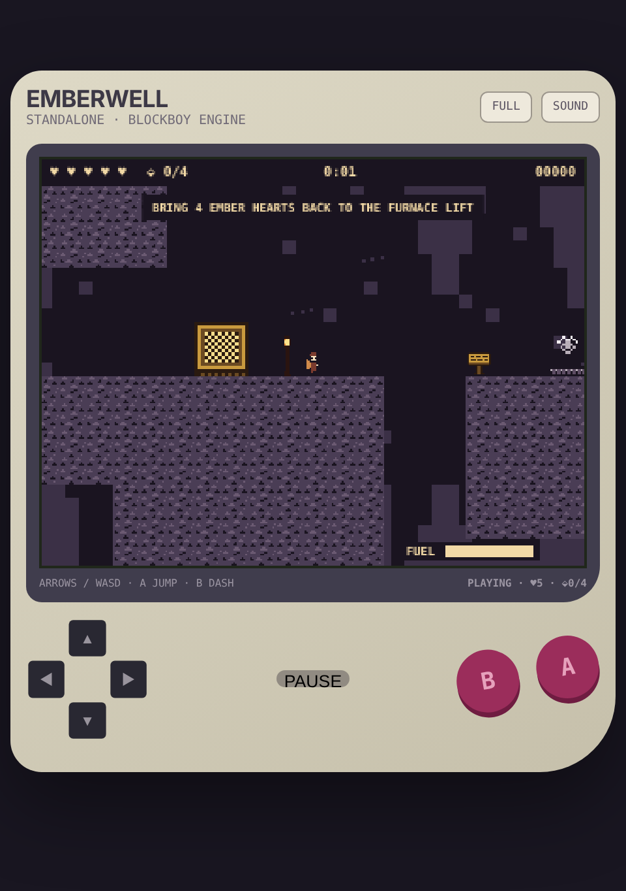</p>

**Emberwell** is a jetpack cave explorer. Four Ember hearts fell from Kettlemoor's furnace into the Underflue caves. Tam the sweep goes down with a steam puffer pack to bring them back to the Furnace lift. The cave is one open scene of 4 × 4 screens, and the hearts can be fetched in any order:

1. **Chimney top:** ride the updraft in the chimney; it lifts harder than the pack can.
2. **Cistern alcove:** carry the heavy anvil stone off its ledge; it sinks onto a weight plate under the water and holds the sluice gate open.
3. **Rubble gallery:** cut the rubble with the cutter (F) from the old toolbox in the mite warren.
4. **Brass vault:** swim down the siphon to the fungus grotto, throw a glowcap to the Gnasher so it eats and dozes, then roll a pebble through the mousehole to ring the old bell, which opens the brass gate. A geyser lifts you back out.

## Play it

- **In your browser:** download [`index.html`](index.html) and open it. The whole game is in that one file and needs no install or internet connection.
- **On the web:** turn on GitHub Pages for this repo (Settings > Pages > Deploy from branch `main`, folder `/`) and the game plays at `https://icakinser.github.io/blockboy-emberwell/`.
- **In BlockBoy:** download [`emberwell-cartridge.json`](emberwell-cartridge.json), then in the editor click **FILE > Open…** and **Browse this computer…** (or drop the file on the Open window) to see and edit every object, block and rule. The game also ships with BlockBoy itself under **FILE > New Game… > EMBERWELL**.

The controls are listed in [Controls in the finished game](#controls-in-the-finished-game) below.

## Screenshots

| | |
|---|---|
| 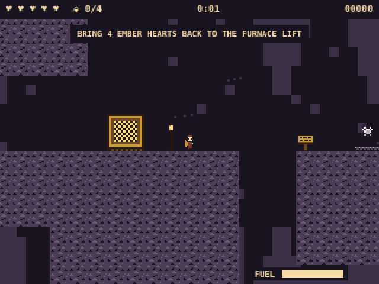<br>The Furnace lift, where Tam starts | 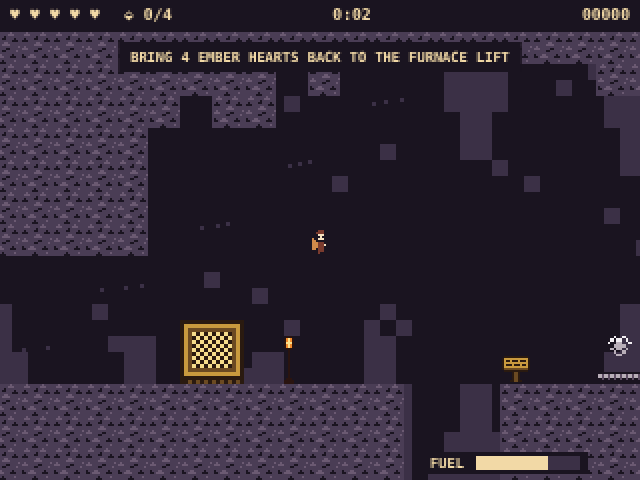<br>Flying with the steam puffer pack |
| 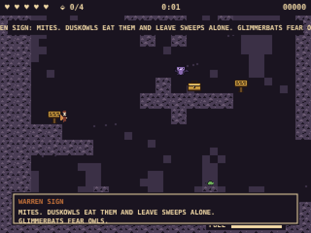<br>The mite warren | 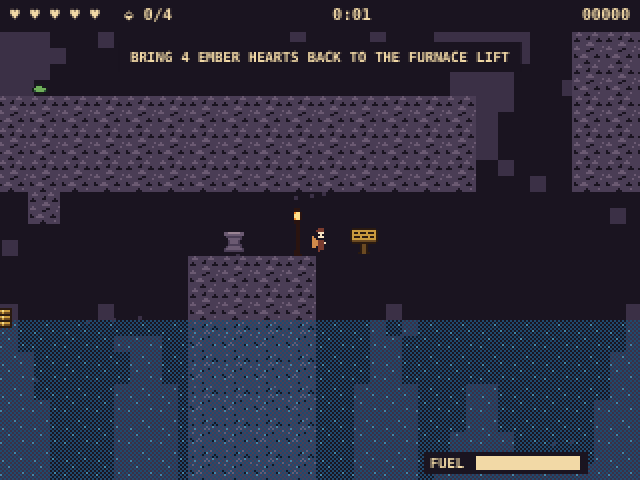<br>The cistern |
| 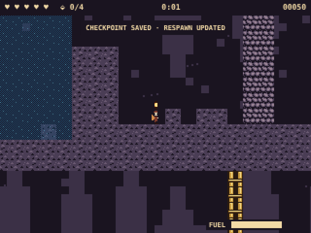<br>The rubble gallery | 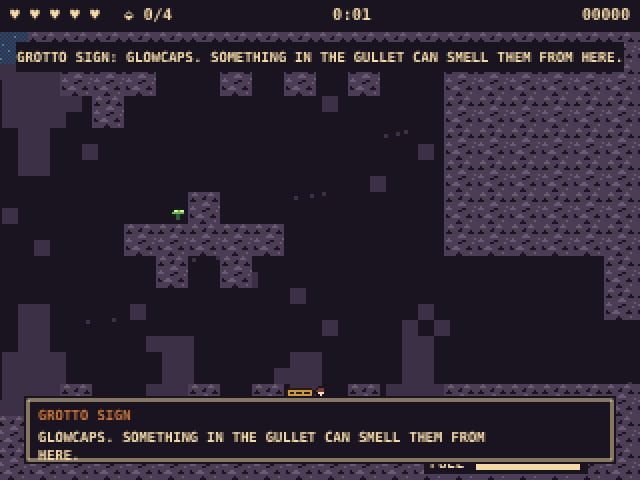<br>The fungus grotto |
| 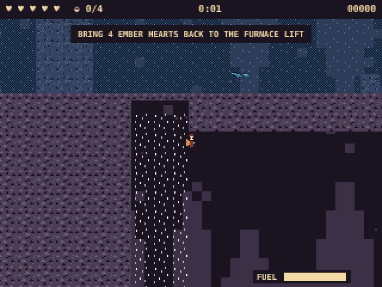<br>The old bell and the brass vault | |

## What's in this repo

| File | What it is |
| --- | --- |
| `index.html` | The standalone game, exported from BlockBoy |
| `emberwell-cartridge.json` | The game's cartridge, for loading into the BlockBoy editor |
| `screenshots/` | The gameplay pictures in this README |
| `EDITOR-BASICS.md` | Where to click in the BlockBoy editor, with annotated screenshots |
| `images/` | Editor screenshots used by the tutorial |
| `sprites/` | The game's pixel art as PNG files, ready to import |

## Tutorial: build Emberwell step by step

**Emberwell** is a jetpack cave explorer. Four Ember hearts fell from Kettlemoor's furnace into the Underflue caves. Tam the sweep goes down with a steam puffer pack to bring them back to the Furnace lift. The cave is one open scene of 4 × 4 screens, and the hearts can be fetched in any order:

1. **Chimney top:** ride the updraft in the chimney; it lifts harder than the pack can.
2. **Cistern alcove:** carry the heavy anvil stone off its ledge; it sinks onto a weight plate under the water and holds the sluice gate open.
3. **Rubble gallery:** cut the rubble with the cutter (F) from the old toolbox in the mite warren.
4. **Brass vault:** swim down the siphon to the fungus grotto, throw a glowcap to the Gnasher so it eats and dozes, then roll a pebble through the mousehole to ring the old bell, which opens the brass gate. A geyser lifts you back out.

This tutorial rebuilds the whole game from an empty cartridge in the BlockBoy editor, object by object, with every block setting and every rule. Every step says exactly what to click, and every object has a picture of how it looks in the editor when it is done. Every block it uses is described in [the block reference](https://github.com/icakinser/Blockboy-Game-Foundry/blob/main/docs/BLOCK-REFERENCE.md).

**What you will learn:** a jetpack hero with fuel and momentum, fuel vents and pickups, carry and throw, physics objects that float, sink, bounce and press plates, water with a current, wind zones and updrafts, an ecosystem of creatures that hunt and flee each other, bait, an impact switch rung by a thrown object, an item found in a chest, and building a big cave map quickly.

**Time:** about 3 hours. The cave rock is the slow part; Part 3 shows the fastest way.

---

### Before you start

#### Learn the editor moves

If you have not used the BlockBoy editor before, read **[BlockBoy editor basics](EDITOR-BASICS.md)** first (10 minutes). It shows, with pictures, where to click for everything this tutorial asks you to do. The steps below link to the right section each time, for example "(how: [§8](EDITOR-BASICS.md#8-place-an-object))".

The moves you will repeat most:

| The tutorial says                            | You do                                                                                                                                                                   |
| -------------------------------------------- | ------------------------------------------------------------------------------------------------------------------------------------------------------------------------ |
| **Place a Spikes**                           | Toolbox > **OBJECTS** tab > click **Spikes** > click the map > click **DONE** ([§8](EDITOR-BASICS.md#8-place-an-object))                                                 |
| **Name Hall vent, at `560, 168, 24 × 24`**   | In the inspector type the name, then X = 560, Y = 168, W = 24, H = 24 ([§9](EDITOR-BASICS.md#9-name-an-object-and-type-its-position-and-size))                           |
| **Remove Hazard**                            | Click the **×** on the Hazard card ([§10](EDITOR-BASICS.md#10-block-cards-turn-off-reorder-remove-and-change-settings))                                                  |
| **Add Fuel cell (Collisions)**               | **ADD COLLISION** > type "Fuel" in the search box > click **Fuel cell** ([§11](EDITOR-BASICS.md#11-add-a-block))                                                         |
| **`Fuel = 2.5`**                             | In that block's card, type 2.5 in the **Fuel** box, or pick the value from its list ([§10](EDITOR-BASICS.md#10-block-cards-turn-off-reorder-remove-and-change-settings)) |
| **Rule `WHEN onStart · TARGET self · DO …`** | **ADVANCED** > **ADD LOGIC RULE** > set WHEN, TARGET and the action ([§14](EDITOR-BASICS.md#14-rules-when--do-))                                                         |
| **Sprite `hall-vent/idle.png`**              | **SPRITE** > **IMPORT PNG / SHEET** > pick the file from this tutorial's `sprites` folder > **SAVE SPRITE** ([§15](EDITOR-BASICS.md#15-sprites-import-or-draw))          |
| **Copy it**                                  | Select the finished object, press **Ctrl+D** (**⌘D** on a Mac) to duplicate it, then type the copy's name and position                                                   |

"Actions" blocks are added with **ADD ACTION**, "Collisions" blocks with **ADD COLLISION**. Anything a step does not mention stays at its default.

#### Get the sprite files

The finished game's pixel art is in the [`sprites/emberwell`](sprites/emberwell) folder next to this tutorial, one folder per object and one PNG per animation. Download it (on GitHub: **Code > Download ZIP**, then unzip) so you can import the pictures instead of drawing them. Each PNG is a strip of frames side by side; IMPORT PNG / SHEET turns it into that many frames. You can of course draw your own instead.

#### Keep the finished game open for comparison

Open a second BlockBoy window (or browser tab), click **BUILD**, then **FILE > New Game… > EMBERWELL**. Play it once with **PLAY** so you know where you are heading. Click any object to see its blocks, or press **/** and type its name.

Then, in your working window, start your own game (Part 1) and save it under its own name with **FILE > Save As…** ([§21](EDITOR-BASICS.md#21-save-your-work)). Save again after every part.

#### Coordinates

Every object gives its position as `x, y, w × h` in pixels: the top-left corner, then the width and height. One screen is 320 × 240. The cave is drawn on a **16 px tile grid**, so most positions are multiples of 16. You never have to drag things into place: type the numbers and the object jumps there.

#### Controls in the finished game

| Key                | Does                                                          |
| ------------------ | ------------------------------------------------------------- |
| Left / Right       | Walk, or push sideways in the air                             |
| Space / Z / Up (A) | Fire the puffer pack (hold)                                   |
| X (B)              | Pick up the thing in front of you; press again to throw it    |
| Down + X           | Roll the carried thing along the floor instead of throwing it |
| F                  | Cutter (after the toolbox)                                    |
| Enter              | Pause                                                         |

---

### Part 1: Set up the scene


The picture shows the scene bar of the finished game. Make yours match.

#### 1.1 Start an empty game

1. Click **BUILD** (top of the screen).
2. Click **FILE > New Game…**, then **EMPTY GAME** ([§2](EDITOR-BASICS.md#2-start-a-new-game)). You get one scene with a ground strip and a hero.

#### 1.2 Name and size the scene

([§4](EDITOR-BASICS.md#4-name-and-size-a-scene), [§5](EDITOR-BASICS.md#5-scene-settings-camera-palette-sky-weather-and-intro))

1. Click the **scene name** box (second box in the top row), select `UNTITLED CART` and type **THE UNDERFLUE**.
2. Click **W**, type **1280**. Click **H**, type **960**. Press **Tab**. The scene is now 4 × 4 screens (80 × 60 tiles).
3. Open the **CAMERA** list and choose **Follow player**. The camera glides with Tam instead of snapping from room to room.
4. Open **SKY** and choose **clear**. Open **HORIZON** and choose **none**. Open **WEATHER** and choose **embers**.
5. Click the **INTRO** box and type `BRING 4 EMBER HEARTS BACK TO THE FURNACE LIFT`.

#### 1.3 Make the palette

([§7](EDITOR-BASICS.md#7-make-your-own-palette))

1. Click **SCENE STUDIO** (top right of the editor), then **MAKE OR EDIT PALETTES…**.
2. Under BUILT IN click **Classic**, then **COPY**.
3. In **NAME**, select the text and type **Emberwell**.
4. Click the **Ink (darkest)** colour square and type `#1a1420` into the picker's hex field. Do the same for **Dark** `#3b3046`, **Light** `#c8743a` and **Paper (lightest)** `#f2d9a6`.

   | Shade         | Emberwell |
   | ------------- | --------- |
   | Ink (darkest) | `#1a1420` |
   | Dark          | `#3b3046` |
   | Light         | `#c8743a` |
   | Paper         | `#f2d9a6` |

5. Click **Emberwell** under YOUR PALETTES, then **USE FOR THIS LEVEL**.
6. Close the palette window with **×**.

#### 1.4 Optional: a cave mural behind the rock

The finished game has a dark cave wall painted on the background that drifts slowly behind the rock. It is decoration only; skip it if you like.

1. In **SCENE STUDIO** click the tab **2 · PAINT CUSTOM MURAL**.
2. Under **DRAWING TOOL** pick **INK** or **DARK** and paint big rough cave shapes on the mural grid: dark everywhere, a little lighter in the middle of the map.
3. Click the tab **1 · BACKGROUND & ATMOSPHERE** and drag **PARALLAX SCROLL** to **20%**, so the mural moves at a fifth of the camera's speed.
4. Click **DONE · EDIT SCENE MAP**.

#### 1.5 Remove the ground strip

Emberwell's floors are made of rock pieces, so the starter ground goes.

1. Click the long ground strip along the bottom of the map. The inspector shows it.
2. Click the **Delete** (bin) button at the top of the inspector, or press the **Delete** key.

#### 1.6 The cave plan

One screen per box:

|                  | x 0 to 320                                | x 320 to 640         | x 640 to 960 | x 960 to 1280  |
| ---------------- | ----------------------------------------- | -------------------- | ------------ | -------------- |
| **y 0 to 240**   | Lamp gallery                              | Furnace hall (start) | Draught hall | Chimney top    |
| **y 240 to 480** | Mite warren                               | Central shaft        | Hollow       | Windpipe       |
| **y 480 to 720** | Cistern (flooded; the current flows east) | Cistern              | Cistern      | Rubble gallery |
| **y 720 to 960** | Fungus grotto                             | Gnasher's gullet     | Bell chamber | Brass vault    |

To see a part of the map while you work, drag it with **Pan** (or hold **Space** and drag), or select an object there with **FIND**. Typed positions always put an object in the right place, wherever you clicked to place it.

---

### Part 2: Tam, the hero

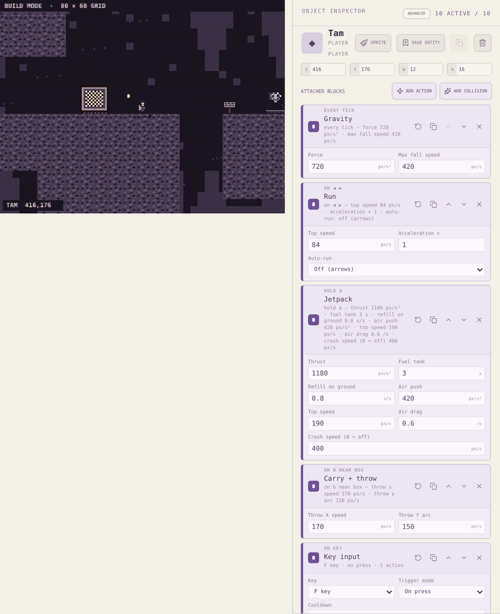

#### 2.1 Position and starter blocks

1. Click the hero the empty game gave you. Name it **Tam** and type `x 416, y 176, w 12, h 16`.
2. Tam does not jump; the pack does the lifting. Remove these starter blocks by clicking the **×** on each card: **Jump, Double jump, Dash, Stomp attack, Dash attack**.
3. Keep **Gravity** and set `Max fall speed = 420` (Force stays 720).
4. Keep **Run** and set `Top speed = 84`.

#### 2.2 The puffer pack

1. Click **ADD ACTION**, type "Jet" in the search box and click **Jetpack**. Set:

   | Setting               | Value | Why                                              |
   | --------------------- | ----- | ------------------------------------------------ |
   | Thrust                | 1180  | Stronger than gravity (720), so holding A climbs |
   | Fuel tank             | 3     | Three seconds of thrust from full                |
   | Refill on ground      | 0.8   | Slow refill while standing, so vents matter      |
   | Air push              | 420   | Sideways control in the air                      |
   | Top speed             | 190   | Momentum cap                                     |
   | Air drag              | 0.6   | How fast momentum fades                          |
   | Crash speed (0 = off) | 400   | Hitting a wall faster than this hurts            |

   Only **Crash speed** differs from the default; the others are listed so you know what they do.

2. Click **ADD ACTION**, search "Carry" and click **Carry + throw**. Set `Throw X speed = 170`, `Throw Y arc = 150`. Anything Tam carries moves with Tam, and its weight slows the climb.

#### 2.3 The cutter (switched off until the toolbox)

([§13](EDITOR-BASICS.md#13-blocks-that-run-other-blocks-key-input-timer))

1. Click **ADD ACTION**, search "Key" and click **Key input**. Set `Key = F key`, `Trigger mode = On press`, `Cooldown = 0.3`.
2. In its **RUN THESE BLOCKS** area open **Add a block to run…** and pick **Hero shot**. In the Hero shot card set:

   | Setting          | Value |
   | ---------------- | ----- |
   | Cooldown         | 0.3   |
   | Projectile speed | 260   |
   | Aim range        | 48    |
   | Projectile count | 1     |
   | Lifetime         | 0.9   |

   The short lifetime makes a cutter that only reaches a little way in front of Tam.

3. Click the round **on/off switch** at the left of the Hero shot card so it turns grey (off). The old toolbox will switch it on (Part 6).

#### 2.4 The blocks Tam keeps

1. **Damage + respawn:** `Max hearts = 5`, `Invulnerable after hit = 1.2`, `Knockback = 140`.
2. Leave **Heart collector**, **Core collector**, **Exit reader** and **Checkpoint reader** as they are. Core collector is what picks up the Ember hearts.

#### 2.5 Sprite

([§15](EDITOR-BASICS.md#15-sprites-import-or-draw))

1. Click **SPRITE**. **SIZE = 16 × 16**.
2. **IDLE** tab: click **IMPORT PNG / SHEET** and choose `sprites/emberwell/tam/idle.png`.
3. Click **+ STATE**, name it `move`, import `tam/move.png` (two frames). Set **FRAME TIME = 0.14**.
4. **+ STATE** `jump`, import `tam/jump.png` (one frame; it is used while falling). **FRAME TIME = 0.14**.
5. **+ STATE** `jet`, import `tam/jet.png` (two frames of the pack firing). **FRAME TIME = 0.14**. The Jetpack block plays `jet` by itself while it thrusts.
6. Click **SAVE SPRITE**.

#### 2.6 World settings

**Environment settings** holds settings for the whole game. It needs an object to sit on, so use a tiny marker that hides itself.

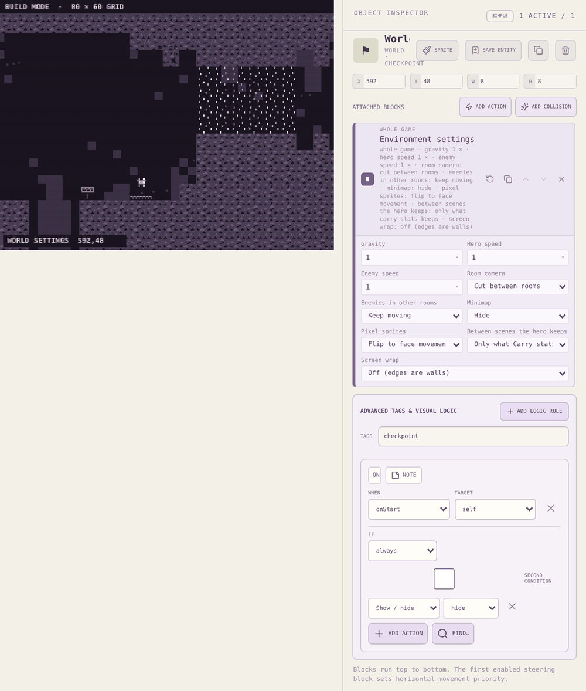

1. Place a **Checkpoint**. Name it **World settings**, at `592, 48, 8 × 8`.
2. Click **×** on its **Checkpoint flag** card.
3. Click **ADD ACTION**, search "Environment" and click **Environment settings**. Set `Minimap = Hide` and `Pixel sprites = Flip to face movement` (Tam faces the way he flies). Leave the rest.
4. Add the rule that hides the marker ([§14](EDITOR-BASICS.md#14-rules-when--do-)):
   1. Click **ADVANCED** (top right of the inspector).
   2. Scroll down and click **ADD LOGIC RULE**.
   3. **WHEN** = `onStart`, **TARGET** = `self`, **IF** = `always`.
   4. In the action row, open the first list and pick **Show / hide**, then pick **hide** in the list beside it.
   5. Click **SIMPLE** to go back to the normal view.

> **Check:** there is nothing to stand on yet, so Tam falls off the map. That is expected; the rock comes next.

---

### Part 3: The rock

The whole cave is **Brick** objects with **Solid body**, 138 pieces in all. [Appendix A](#appendix-a-rock-pieces) lists every piece with its name, x, y, w and h. The map below shows the same layout: each character is one 16 px tile, `#` is rock and `.` is open cave. Column numbers run across the top (tens, then units); row numbers down the side. A tile at column `c`, row `r` sits at `x = 16 × c`, `y = 16 × r`.

```text
          1111111111222222222233333333334444444444555555555566666666667777777777
01234567890123456789012345678901234567890123456789012345678901234567890123456789
################################################################################  0
################################################################################  1
#########################.#........############.......#....#####################  2
##.###.....#...#######.##............#.######.#.......#....#####.............###  3
##..#..........######......................................#####.............###  4
##..............#####......................................#####.............###  5
##....####......#####............................#####.....#####....############  6
##.....#........#####.............................##.#.....#####....############  7
##.....................................######.#............#####....############  8
##.....................................#########...........#####....############  9
##.....................................#########...........#####....############ 10
##....................................##########...........#####....############ 11
##....#######################...################...........#####....############ 12
##....#######################...##################...###########....############ 13
##....#######################...##################...###########....############ 14
##....#######################...##################...###########....############ 15
##......####..#....##########...##################...###########....############ 16
##.......#.#.......##########...#########.#...##.......#.......#....############ 17
##.................##########.................##.......#.......#....############ 18
##.................##########..................................#....############ 19
##........#........##########..........................................###.##.## 20
##.......######....##########...#########.....#..#......................##.##.## 21
##.........#.......##########...#########.....#####...........................## 22
####...............##########...#########......#..#...........................## 23
######..........................#########......#..............................## 24
##..............................#########.....................................## 25
##..............................#########.....................................## 26
##....#......#..................#########...........##................##......## 27
#############################...################################################ 28
#############################...################################################ 29
#############################...################################################ 30
##........#....#.............................##.#....#.###........##.##.......## 31
##...........................................#.......#.###........##..........## 32
##..................####...............................###....................## 33
##..................####............###.......................................## 34
#########...........####............###.......................................## 35
##..................####............###.......................................## 36
##..................####............###.......................................## 37
##..................####............###................###....................## 38
##..................####............###................###....................## 39
##..................####............###................###....................## 40
##..................####............###................###....................## 41
##..................####............###................###...#.##.#.......#...## 42
##..................####............###..............#.######################### 43
##...####################################...#################################### 44
##...####################################...#################################### 45
##...####################################.....................................## 46
##....###..#.#.#..#######################.....................................## 47
##.....#..........#######################.....................................## 48
##................#######################.....................................## 49
##................#######################.....................................## 50
##........#.......#######################.....................................## 51
##......#####.....#######################..................#######............## 52
##.......#.#...........##################..................#######............## 53
##.....................##################..................#..####............## 54
##.........................................................#..####............## 55
##............................................................####............## 56
###...#...#.#..#..############################################################## 57
################################################################################ 58
################################################################################ 59
```

Leave these gaps open, the puzzles depend on them:

- **The central shaft** (columns 29 to 31, rows 12 to 30): the main way down from the Furnace hall to the cistern.
- **The chimney** (columns 64 to 67, rows 3 to 27): the updraft column.
- **The siphon** (columns 2 to 4, rows 44 to 46): the underwater passage from the cistern down to the fungus grotto.
- **The gullet** (columns 41 to 43, rows 44 to 45): the way from the bell chamber up into the cistern, where the geyser goes.
- **The mousehole** at column 59, row 56: you add a thin lip over it in Part 10.

#### 3.1 Build the first rock piece with its sprite

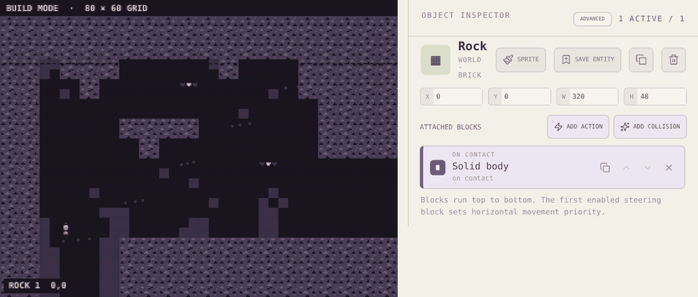

1. Place a **Brick**. Name it **Rock 1**, at `0, 0, 320 × 48`. Keep its **Solid body**.
2. Click **SPRITE**. **SIZE = 16 × 16**. Import `sprites/emberwell/rock-1/idle.png` into **IDLE**.
3. Open **ON BIG OBJECTS** and choose **Repeat as tiles**, so the 16 × 16 rock texture repeats across the whole piece instead of stretching.
4. Click **SAVE SPRITE**.

#### 3.2 Copy it for every other piece

1. With **Rock 1** selected, press **Ctrl+D** (**⌘D** on a Mac). A copy appears, already selected, with the same sprite.
2. Type the next row of [Appendix A](#appendix-a-rock-pieces): name **Rock 2**, X `320`, Y `0`, W `320`, H `32`.
3. Press **Ctrl+D** again on the copy and type the next row. Repeat down the table.

No single object can be bigger than one screen (320 × 240), so the long bands of rock are cut into screen-sized pieces; the appendix already does that for you.

Faster but plainer: click **Brush** in the toolbar, click **Brick** in the Toolbox, set **SNAP = 16**, and drag one rectangle over each block of `#` in the map ([§18](EDITOR-BASICS.md#18-paint-walls-quickly-with-the-brush)). Click **Brush** again before each new rectangle. Brushed pieces have no rock sprite, so they draw as plain bricks; they play exactly the same.

> **Check:** click **PLAY**. Tam stands on the Furnace hall floor, holds Space to rise, drifts with momentum and comes down again. Press **E** to return to the editor.

---

### Part 4: The Furnace hall (start)

#### Furnace lift (the goal)

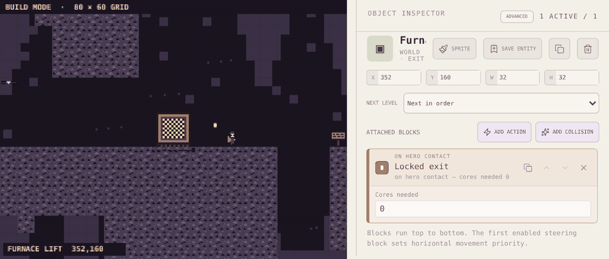

1. Place an **Exit**. Name **Furnace lift**, at `352, 160, 32 × 32`.
2. Keep **Locked exit** as it is. It opens once every object with **Collectible core** (the four Ember hearts) has been collected.
3. **SPRITE** > import `furnace-lift/idle.png` (a brass lift cage) > **SAVE SPRITE**.

#### Hall lamp (a checkpoint)

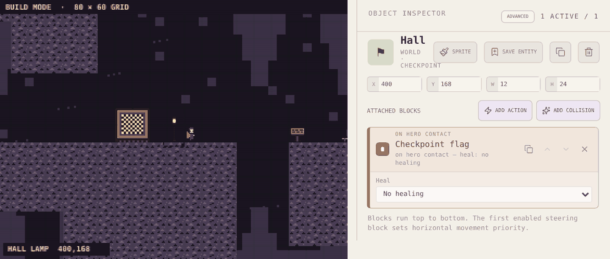

1. Place a **Checkpoint**. Name **Hall lamp**, at `400, 168, 12 × 24`. Keep **Checkpoint flag**.
2. **SPRITE** > import `hall-lamp/idle.png` > **SAVE SPRITE**.

Every lamp in the cave is a checkpoint with this sprite. You will copy it with **Ctrl+D** three more times later.

#### Hall vent (refuel)

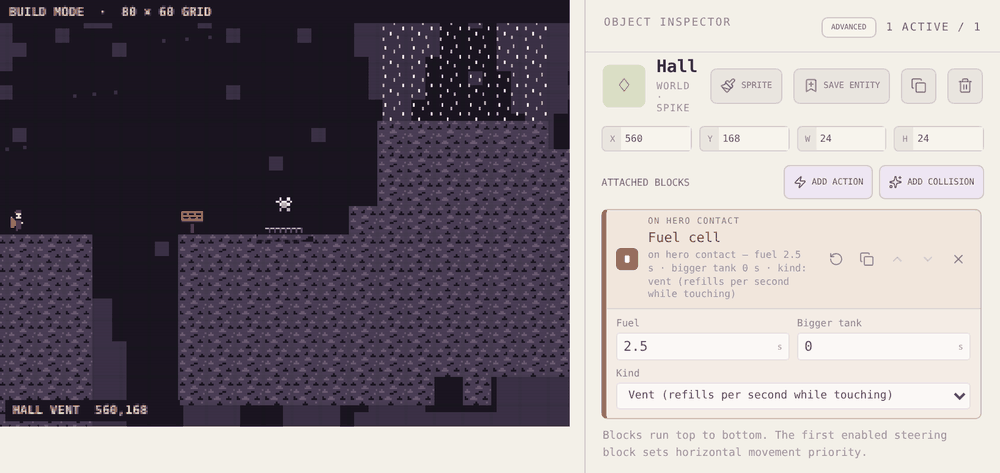

1. Place a **Spikes**. Name **Hall vent**, at `560, 168, 24 × 24`.
2. Click **×** on **Hazard**.
3. **ADD COLLISION** > search "Fuel" > **Fuel cell**. Set `Fuel = 2.5` and `Kind = Vent (refills per second while touching)`. A vent refills 2.5 seconds of fuel per second while Tam stands in it and never runs out.
4. **SPRITE** > import `hall-vent/idle.png` (two frames, so it puffs) > **FRAME TIME = 0.25** > **SAVE SPRITE**.

There are three more vents in the cave; copy this one with **Ctrl+D** when you get there.

#### Keeper's note (a sign)

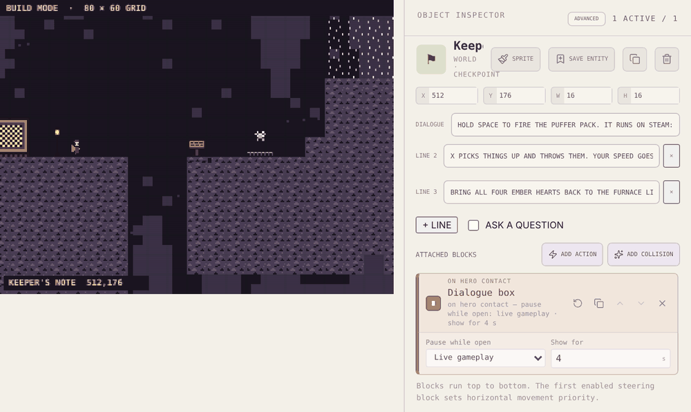

1. Place a **Checkpoint**. Name **Keeper's note**, at `512, 176, 16 × 16`.
2. Click **×** on **Checkpoint flag**.
3. **ADD COLLISION** > search "Dialogue" > **Dialogue box**. Set `Pause while open = Live gameplay`, `Show for = 4`.
4. Type the text ([§12](EDITOR-BASICS.md#12-dialogue-text)): click the **DIALOGUE** box and type the first line, then click **+ LINE** for each next line:
   1. `HOLD SPACE TO FIRE THE PUFFER PACK. IT RUNS ON STEAM: VENTS AND CELLS REFILL IT.`
   2. `X PICKS THINGS UP AND THROWS THEM. YOUR SPEED GOES WITH THEM.`
   3. `BRING ALL FOUR EMBER HEARTS BACK TO THE FURNACE LIFT.`
5. **SPRITE** > import `keeper-s-note/idle.png` (a sign) > **SAVE SPRITE**.

There are five more signs. Copy this one with **Ctrl+D** for each and change only its name, position and text.

> **Check:** play. Tam walks, rises with Space, and refuels standing in the vent (watch the fuel gauge). Walking past the note shows its three lines.

---

### Part 5: The creatures

Emberwell's creatures use **Creature instincts**: each belongs to a numbered group and can hunt one group and fear another. Glowcaps join the food chain through **Creature scent**. The groups:

| Group | Who                                 | Hunts        | Fears    |
| ----- | ----------------------------------- | ------------ | -------- |
| 1     | Mites                               | nothing      | owls (2) |
| 2     | Duskowls                            | mites (1)    | nothing  |
| 3     | Glowcaps (bait, via Creature scent) |              |          |
| 4     | Gnasher                             | glowcaps (3) | nothing  |
| 5     | Glimmerbats                         | the hero     | owls (2) |
| 6     | Eels                                | the hero     | nothing  |

Each kind of creature is built once, completely, then copied with **Ctrl+D**. The steps for each one are in the part where it first appears.

---

### Part 6: West: the Lamp gallery and the Mite warren

#### Glimmerbats (Gallery bat A and B)

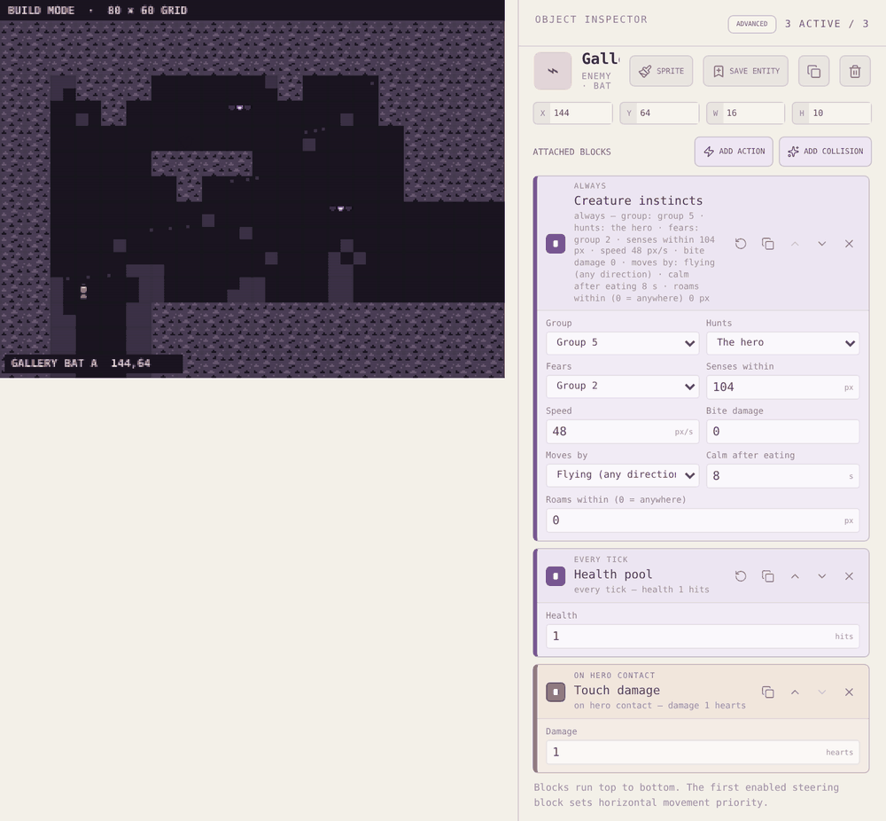

1. Place a **Gloom bat**. Name **Gallery bat A**, at `144, 64, 16 × 10`.
2. Click **×** on **Hover**, **Chase** and **Stompable**. Keep **Touch damage** (`Damage = 1`).
3. **ADD ACTION** > search "Creature" > **Creature instincts**. Set:

   | Setting       | Value                  |
   | ------------- | ---------------------- |
   | Group         | Group 5                |
   | Hunts         | The hero               |
   | Fears         | Group 2                |
   | Senses within | 104                    |
   | Speed         | 48                     |
   | Bite damage   | 0                      |
   | Moves by      | Flying (any direction) |

   Bite damage is 0 because Touch damage already hurts Tam; bites are for creatures eating each other.

4. **ADD ACTION** > search "Health" > **Health pool**. Set `Health = 1`. One cutter hit downs it.
5. **SPRITE** > import `gallery-bat-a/idle.png` into IDLE, then **+ STATE** `move`, import `gallery-bat-a/move.png` (wing flap), **FRAME TIME = 0.12** > **SAVE SPRITE**.
6. Press **Ctrl+D**. Name the copy **Gallery bat B**, at `208, 128`.

#### Gallery heart and gallery cell

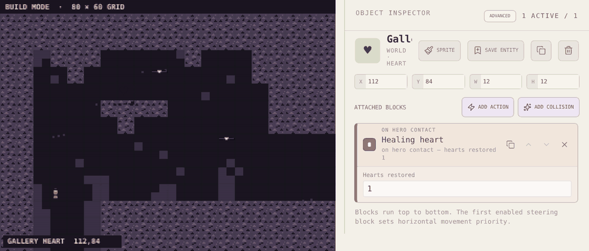

1. Place a **Heart**. Name **Gallery heart**, at `112, 84, 12 × 12`. Keep **Healing heart**.

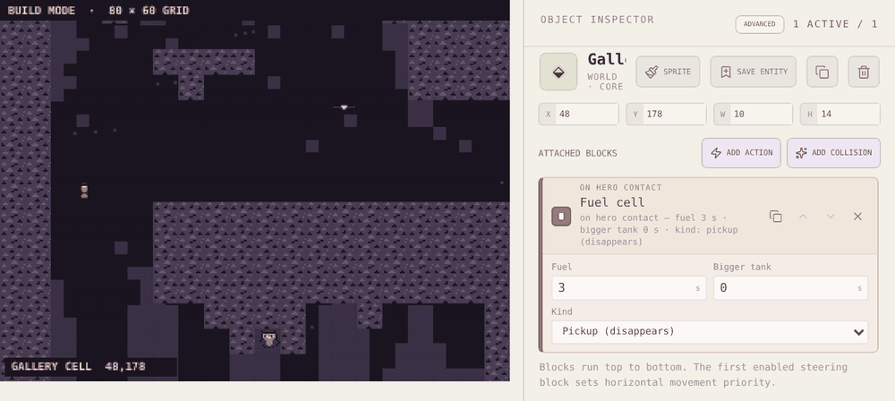

2. Place a **Core**. Name **Gallery cell**, at `48, 178, 10 × 14`.
3. Click **×** on **Collectible core**. This matters: every object that keeps Collectible core must be collected before the Furnace lift opens.
4. **ADD COLLISION** > **Fuel cell**. Leave it at `Fuel = 3`, `Kind = Pickup (disappears)`: a full tank you pick up once.
5. **SPRITE** > import `gallery-cell/idle.png` (a brass cell) > **SAVE SPRITE**.

#### The Warren owl (a duskowl)

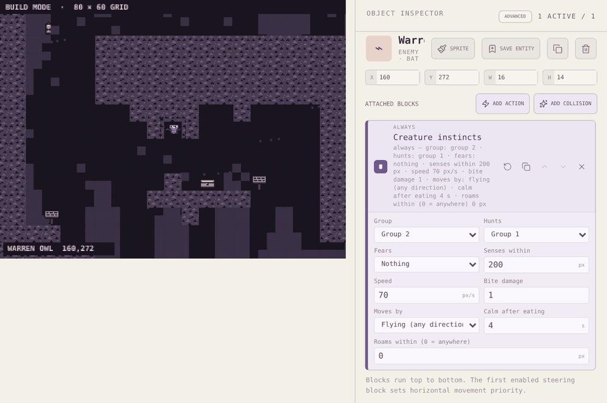

1. Place a **Gloom bat**. Name **Warren owl**, at `160, 272, 16 × 14`.
2. Click **×** on all four starter blocks: **Hover**, **Chase**, **Stompable**, **Touch damage**. Owls ignore Tam.
3. **ADD ACTION** > **Creature instincts**: `Group = Group 2`, `Hunts = Group 1`, `Fears = Nothing`, `Senses within = 200`, `Speed = 70`, `Bite damage = 1`, `Moves by = Flying (any direction)`, `Calm after eating = 4`.
4. **SPRITE** > import `warren-owl/idle.png`, **+ STATE** `move`, import `warren-owl/move.png`, **FRAME TIME = 0.18** > **SAVE SPRITE**.

#### Mites A to D

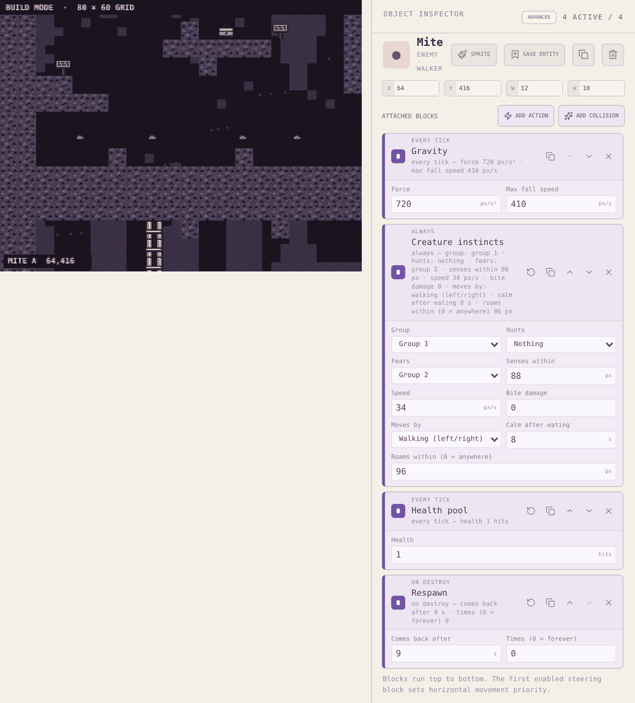

1. Place a **Muck**. Name **Mite A**, at `64, 416, 12 × 10`.
2. Keep **Gravity**. Click **×** on **Patrol**, **Stompable** and **Touch damage**.
3. **ADD ACTION** > **Creature instincts**: `Group = Group 1`, `Hunts = Nothing`, `Fears = Group 2`, `Senses within = 88`, `Speed = 34`, `Bite damage = 0`, `Moves by = Walking (left/right)`, `Roams within (0 = anywhere) = 96`.
4. **ADD ACTION** > **Health pool**: `Health = 1`.
5. **ADD ACTION** > search "Respawn" > **Respawn**: `Comes back after = 9`, `Times (0 = forever) = 0`. Eaten mites come back, so the owl never runs out of food.
6. **SPRITE** > import `mite-a/idle.png`, **+ STATE** `move`, import `mite-a/move.png`, **FRAME TIME = 0.15** > **SAVE SPRITE**.
7. **Ctrl+D** three times for **Mite B** at `128, 416`, **Mite C** at `208, 416` and **Mite D** at `256, 416`.

#### Warren sign

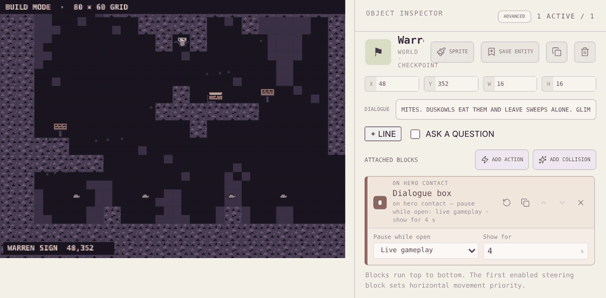

1. Select **Keeper's note** (press **/** and type its name), press **Ctrl+D**.
2. Name the copy **Warren sign**, at `48, 352`.
3. Replace its text with one line (remove LINE 2 and LINE 3 with their **×**): `MITES. DUSKOWLS EAT THEM AND LEAVE SWEEPS ALONE. GLIMMERBATS FEAR OWLS.`

#### The old toolbox (the cutter)

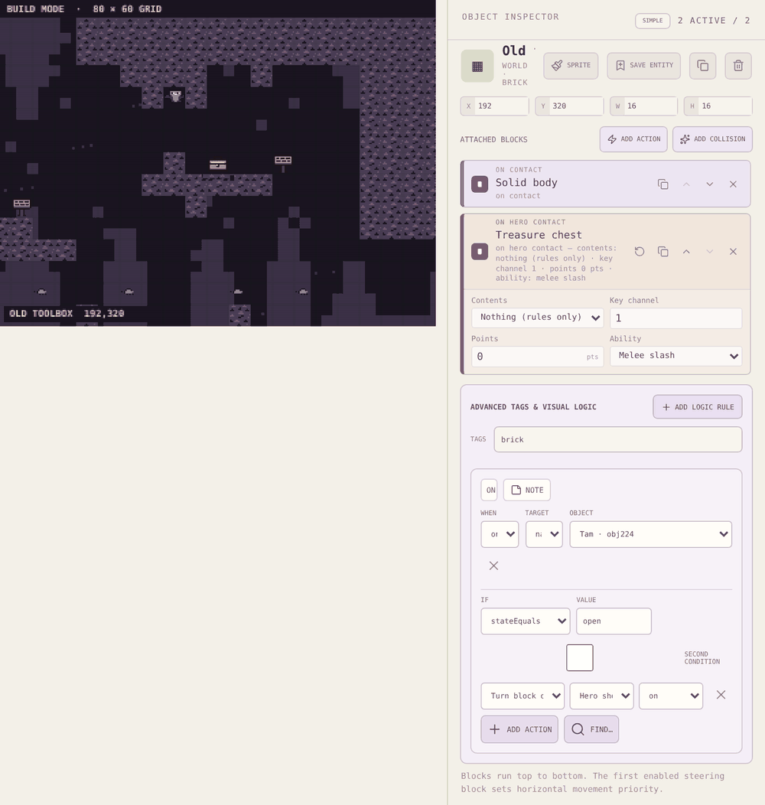

1. Place a **Brick**. Name **Old toolbox**, at `192, 320, 16 × 16`. Keep **Solid body**.
2. **ADD COLLISION** > search "Treasure" > **Treasure chest**. Set `Contents = Nothing (rules only)` and `Points = 0`. The chest itself gives nothing; a rule does the work.
3. **SPRITE** > import `old-toolbox/idle.png` (closed) into IDLE, then **+ STATE** `open`, import `old-toolbox/open.png`, **FRAME TIME = 0.2** > **SAVE SPRITE**. The chest switches to `open` when Tam opens it.
4. Add the rule ([§14](EDITOR-BASICS.md#14-rules-when--do-)):
   1. **ADVANCED** > scroll down > **ADD LOGIC RULE**.
   2. **WHEN** = `onState`.
   3. **TARGET** = `named`, then pick **Tam** in the name list that appears.
   4. **IF** = `stateEquals`, then type `open` in the **VALUE** box that appears beside it.
   5. Action: pick **Turn block on / off**, then pick **Hero shot** and **on**.
   6. Click **SIMPLE**.

   In words: when the toolbox's state becomes `open`, switch on the Hero shot inside Tam's F Key input.

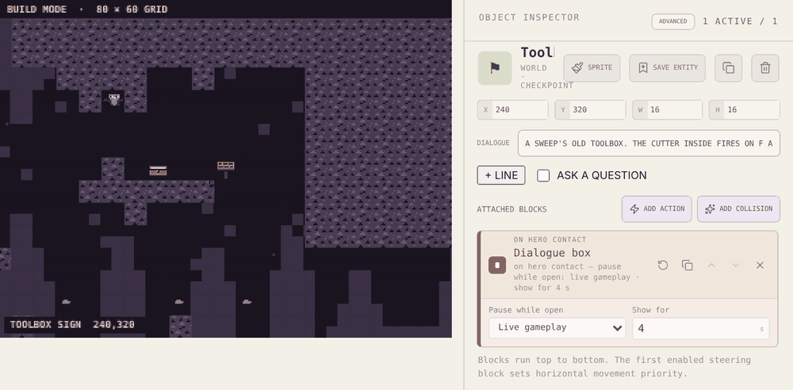

5. Copy a sign (**Ctrl+D** on Warren sign). Name **Toolbox sign**, at `240, 320`. Text: `A SWEEP'S OLD TOOLBOX. THE CUTTER INSIDE FIRES ON F AND CUTS RUBBLE.`

> **Check:** play and fly west. The bats chase Tam but scatter from the owl. Watch the owl swoop on the mites and the mites scatter. Open the toolbox (walk into it) and press F: Tam fires short cutter shots.

---

### Part 7: East: the Draught hall, the Hollow and the Chimney (heart 1)

#### Draught (a breeze)

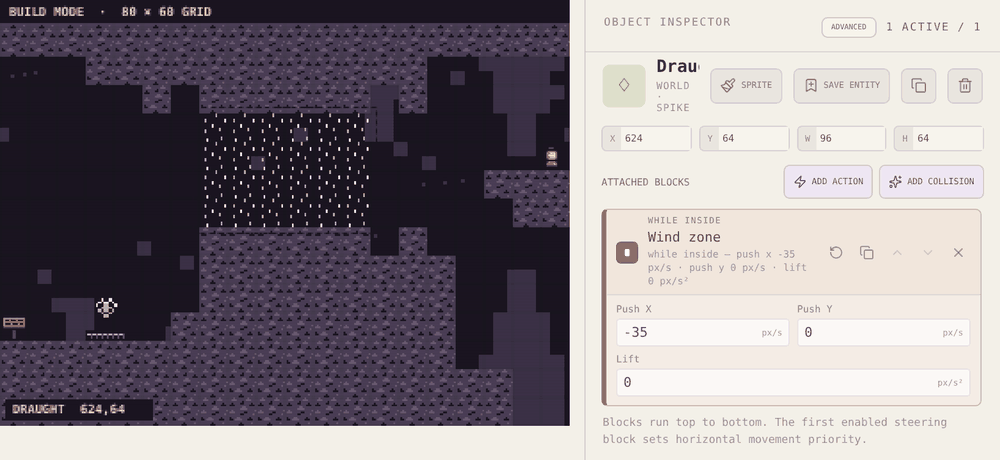

1. Place a **Spikes**. Name **Draught**, at `624, 64, 96 × 64`.
2. Click **×** on **Hazard**.
3. **ADD COLLISION** > search "Wind" > **Wind zone**. Set `Push X = -35`, leave `Push Y = 0`, `Lift = 0`. A steady breeze to the west.
4. **SPRITE** > import `draught/idle.png` (four frames of faint streaks), **FRAME TIME = 0.12**, **ON BIG OBJECTS = Repeat as tiles** > **SAVE SPRITE**.

#### Big tank (a permanent upgrade)

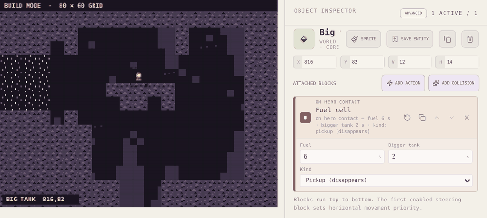

1. Place a **Core**. Name **Big tank**, at `816, 82, 12 × 14`.
2. **×** on **Collectible core**.
3. **ADD COLLISION** > **Fuel cell**: `Fuel = 6`, `Bigger tank = 2`, `Kind = Pickup (disappears)`. It raises the tank from 3 to 5 seconds for good.
4. **SPRITE** > import `big-tank/idle.png` > **SAVE SPRITE**.

#### The Hollow

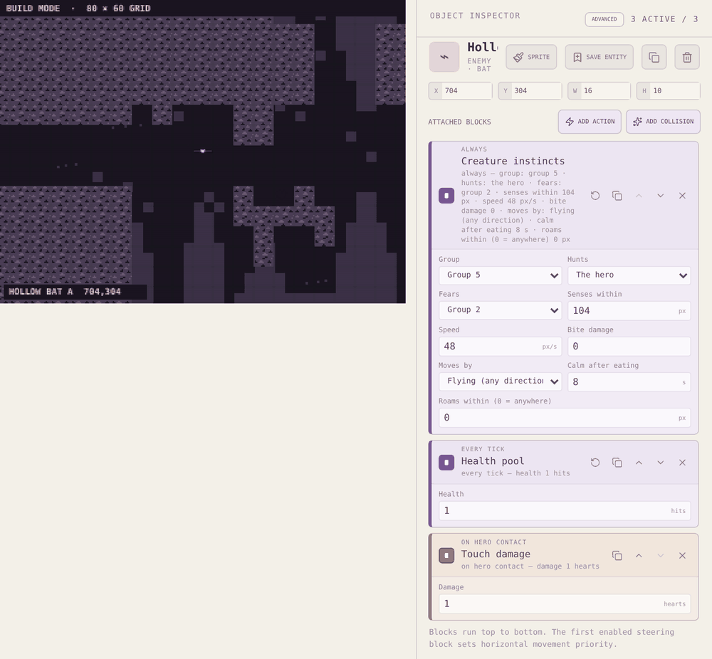

1. Select **Gallery bat A**, **Ctrl+D**, name **Hollow bat A**, at `704, 304`.
2. **Ctrl+D** again: **Hollow bat B** at `912, 384`.

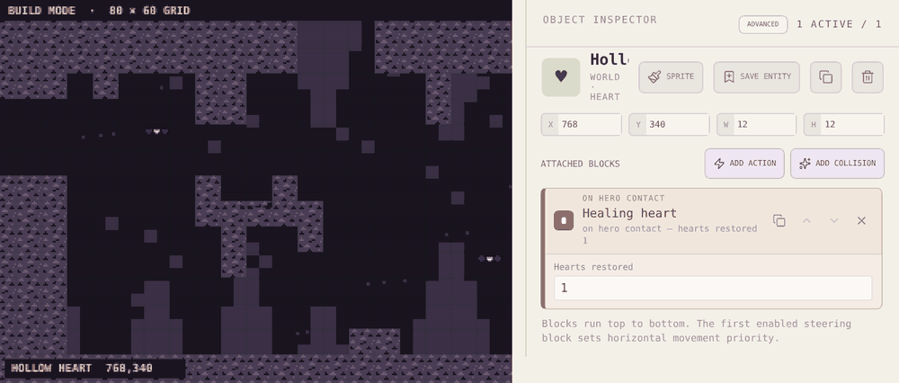

3. Select **Gallery heart**, **Ctrl+D**, name **Hollow heart**, at `768, 340`.

#### Windpipe vent

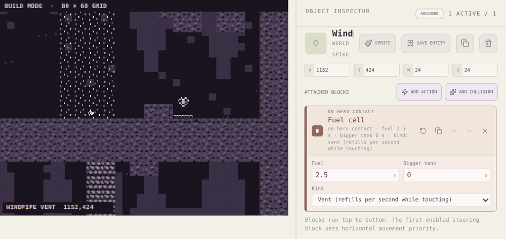

1. Select **Hall vent**, **Ctrl+D**, name **Windpipe vent**, at `1152, 424`.

#### The chimney updraft

One object can be at most one screen tall, so the draught is two pieces.

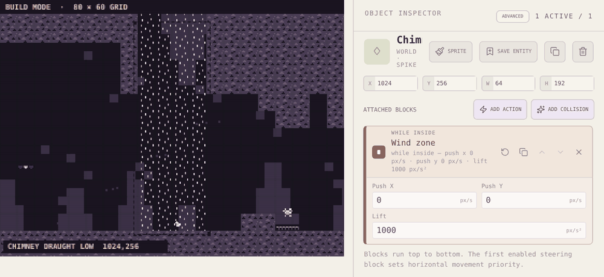

1. Select **Draught**, **Ctrl+D**. Name **Chimney draught low**, at `1024, 256, 64 × 192`.
2. In its Wind zone set `Push X = 0`, `Push Y = 0`, `Lift = 1000`. Lift stronger than the hero's gravity makes an updraft that carries Tam up without fuel.

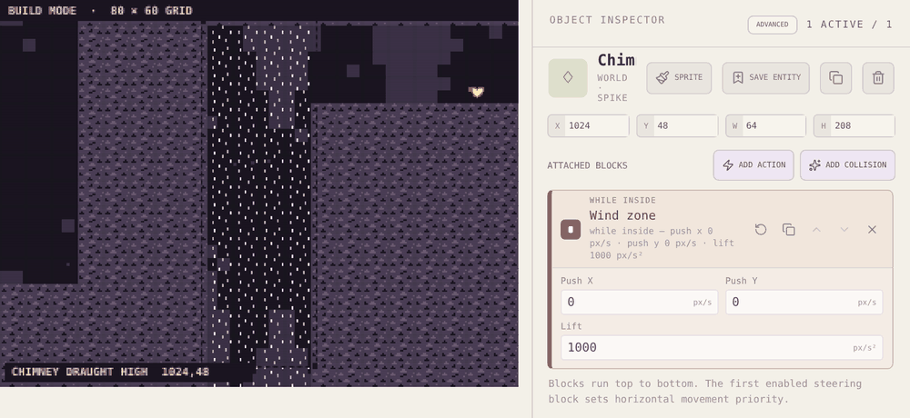

3. **Ctrl+D** on the low piece. Name **Chimney draught high**, at `1024, 48, 64 × 208`.

#### Puffball (a toy that shows the draught)

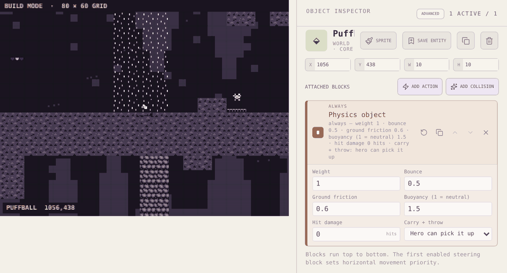

1. Place a **Core**. Name **Puffball**, at `1056, 438, 10 × 10`.
2. **×** on **Collectible core**.
3. **ADD COLLISION** > search "Physics" > **Physics object**: `Weight = 1`, `Bounce = 0.5`, `Buoyancy (1 = neutral) = 1.5`, `Hit damage = 0`, `Carry + throw = Hero can pick it up`. It floats up the chimney on its own, showing players the draught.
4. **SPRITE** > import `puffball/idle.png` > **SAVE SPRITE**.

#### Ember heart: chimney

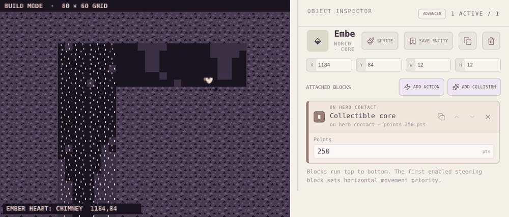

1. Place a **Core**. Name **Ember heart: chimney**, at `1184, 84, 12 × 12`.
2. Keep **Collectible core** (`Points = 250`).
3. **SPRITE** > import `ember-heart-chimney/idle.png` (two glowing frames), **FRAME TIME = 0.35** > **SAVE SPRITE**.

The other three hearts are copies of this one.

> **Check:** fly east. The breeze nudges Tam west; the puffball drifts up the chimney. Fly into the chimney: the updraft carries Tam to the top. Collect the heart.

---

### Part 8: The Cistern (heart 2)

#### 8.1 Water

Water zones are **Spikes** with Hazard removed and **Water zone** added. The cistern spans x 32 to 880, y 560 to 704, split into screen-wide pieces.

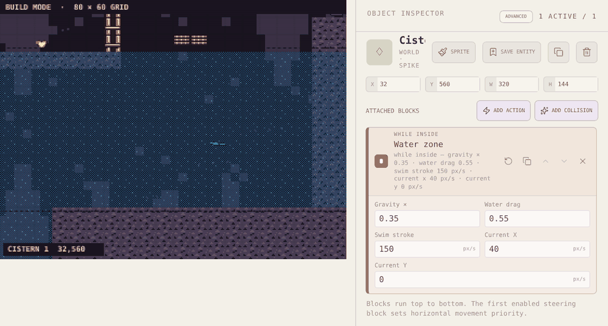

1. Place a **Spikes**. Name **Cistern 1**, at `32, 560, 320 × 144`.
2. **×** on **Hazard**.
3. **ADD COLLISION** > search "Water" > **Water zone**: `Swim stroke = 150`, `Current X = 40`. Leave `Gravity × = 0.35`, `Water drag = 0.55`, `Current Y = 0`. The current pushes everything in the water east at 40 px/s.
4. **SPRITE** > import `cistern-1/idle.png` (two frames), **FRAME TIME = 0.5**, **ON BIG OBJECTS = Repeat as tiles** > **SAVE SPRITE**.
5. Copy it with **Ctrl+D** for the other pieces:

   | Name      | x   | y   | w × h     | Current X |
   | --------- | --- | --- | --------- | --------- |
   | Cistern 2 | 352 | 560 | 320 × 144 | 40        |
   | Cistern 3 | 672 | 560 | 208 × 144 | 40        |
   | Siphon 1  | 32  | 704 | 48 × 48   | 0         |

   The siphon has no current: set its **Current X** back to `0`.

#### 8.2 Lamp, vent and sign

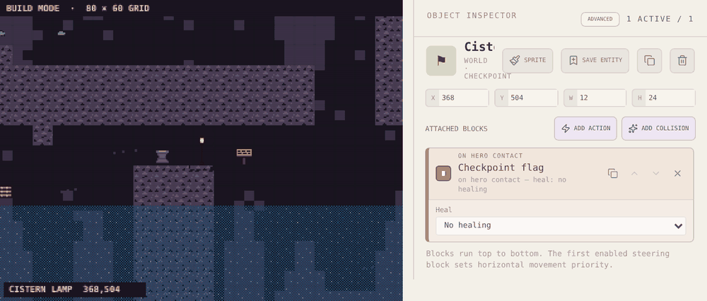

1. Copy **Hall lamp**: **Cistern lamp** at `368, 504`.

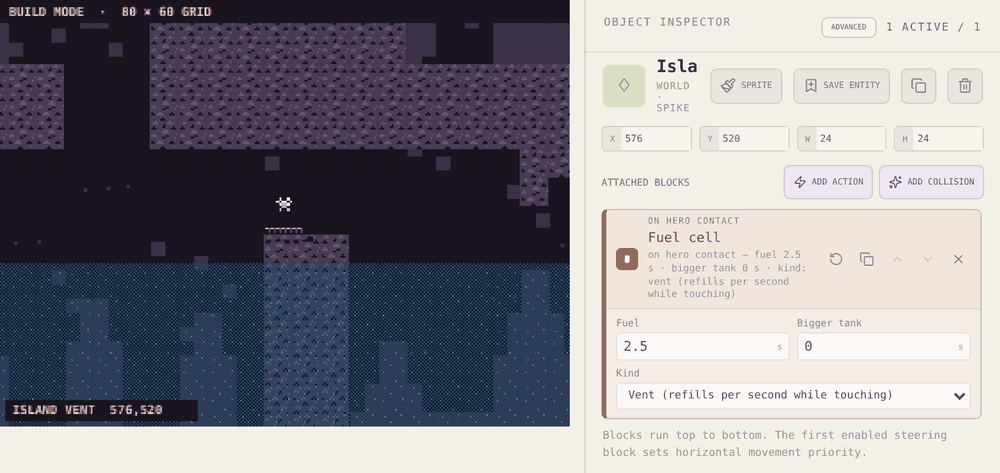

2. Copy **Hall vent**: **Island vent** at `576, 520`.

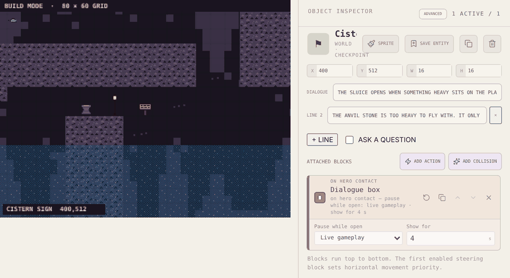

3. Copy a sign: **Cistern sign** at `400, 512`, two lines:
   1. `THE SLUICE OPENS WHEN SOMETHING HEAVY SITS ON THE PLATE BELOW.`
   2. `THE ANVIL STONE IS TOO HEAVY TO FLY WITH. IT ONLY GOES DOWN.`

#### 8.3 The sluice puzzle

The heart sits in an alcove at the far west behind a sluice gate. A weight plate on the cistern floor opens it, but only something heavy can hold it down, and the only heavy thing is the anvil stone on a ledge above the water.

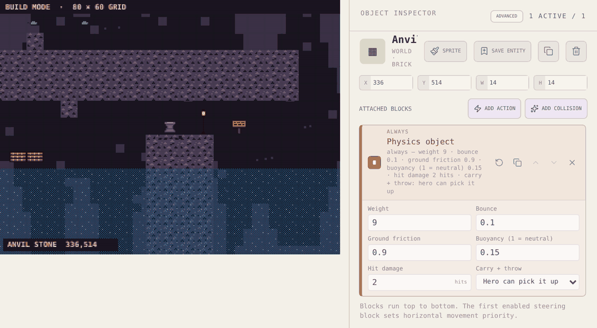

1. Place a **Brick**. Name **Anvil stone**, at `336, 514, 14 × 14`.
2. **×** on **Solid body**.
3. **ADD COLLISION** > **Physics object**:

   | Setting                | Value               | Why                                                    |
   | ---------------------- | ------------------- | ------------------------------------------------------ |
   | Weight                 | 9                   | Counts as 3 on a weight plate (weight ÷ 3, rounded up) |
   | Bounce                 | 0.1                 |                                                        |
   | Ground friction        | 0.9                 |                                                        |
   | Buoyancy (1 = neutral) | 0.15                | Sinks fast                                             |
   | Hit damage             | 2                   |                                                        |
   | Carry + throw          | Hero can pick it up |                                                        |

   It is so heavy that Tam cannot fly while carrying it: it only goes down.

4. **SPRITE** > import `anvil-stone/idle.png` > **SAVE SPRITE**.

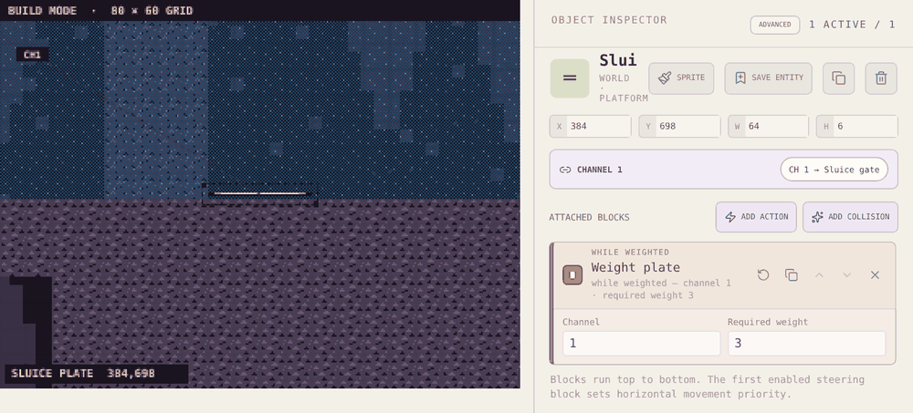

5. Place a **Platform**. Name **Sluice plate**, at `384, 698, 64 × 6`, on the cistern floor.
6. **×** on **One-way top**.
7. **ADD COLLISION** > search "Weight" > **Weight plate**: `Channel = 1`, `Required weight = 3`.
8. **SPRITE** > import `sluice-plate/idle.png` > **SAVE SPRITE**.

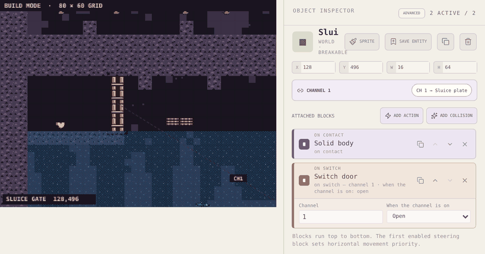

9. Place a **Cracked wall**. Name **Sluice gate**, at `128, 496, 16 × 64`.
10. Keep **Solid body**, click **×** on **Dash breakable**.
11. **ADD COLLISION** > search "Switch door" > **Switch door**: `Channel = 1`, `When the channel is on = Open`. Same channel as the plate.
12. **SPRITE** > import `sluice-gate/idle.png` (brass bars), **ON BIG OBJECTS = Repeat as tiles** > **SAVE SPRITE**.

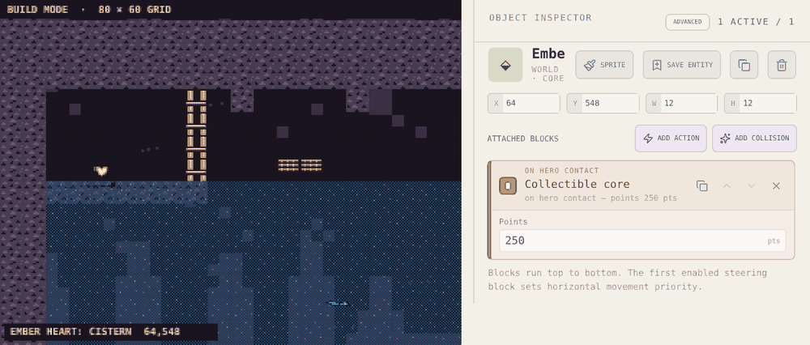

13. Copy **Ember heart: chimney**: **Ember heart: cistern** at `64, 548`.

#### 8.4 The cork raft

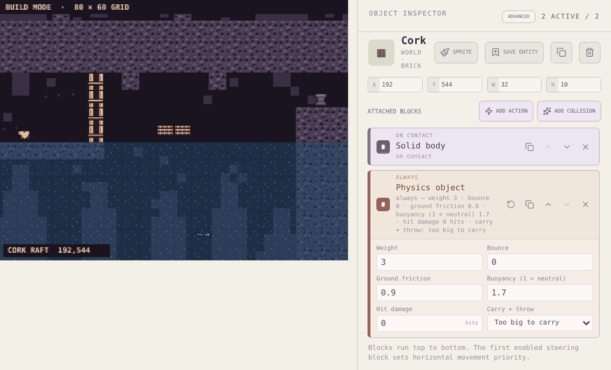

1. Place a **Brick**. Name **Cork raft**, at `192, 544, 32 × 10`. Keep **Solid body** so Tam can stand on it.
2. **ADD COLLISION** > **Physics object**: `Weight = 3`, `Bounce = 0`, `Ground friction = 0.9`, `Buoyancy (1 = neutral) = 1.7`, `Hit damage = 0`, `Carry + throw = Too big to carry`. It floats and drifts east with the current; Tam can ride it.
3. **SPRITE** > import `cork-raft/idle.png`, **ON BIG OBJECTS = Repeat as tiles** > **SAVE SPRITE**.

#### 8.5 Eels

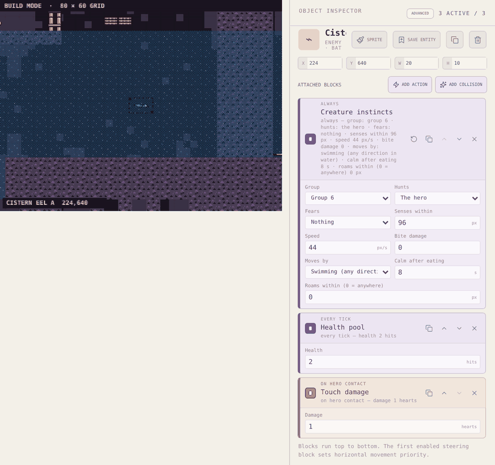

1. Place a **Gloom bat**. Name **Cistern eel A**, at `224, 640, 20 × 10`.
2. **×** on **Hover**, **Chase** and **Stompable**. Keep **Touch damage**.
3. **ADD ACTION** > **Creature instincts**: `Group = Group 6`, `Hunts = The hero`, `Fears = Nothing`, `Senses within = 96`, `Speed = 44`, `Bite damage = 0`, `Moves by = Swimming (any direction in water)`.
4. **ADD ACTION** > **Health pool**, leave `Health = 2`.
5. **SPRITE** > import `cistern-eel-a/idle.png`, **+ STATE** `move`, import `cistern-eel-a/move.png`, **FRAME TIME = 0.2** > **SAVE SPRITE**.
6. **Ctrl+D**: **Cistern eel B** at `704, 656`.

> **Check:** pick up the anvil stone (X), walk off the ledge into the water above the plate and drop it (X again). It sinks onto the plate and the gate opens. Swim west for the heart. The raft drifts east; the eels follow Tam only in the water.

---

### Part 9: The Rubble gallery (heart 3)

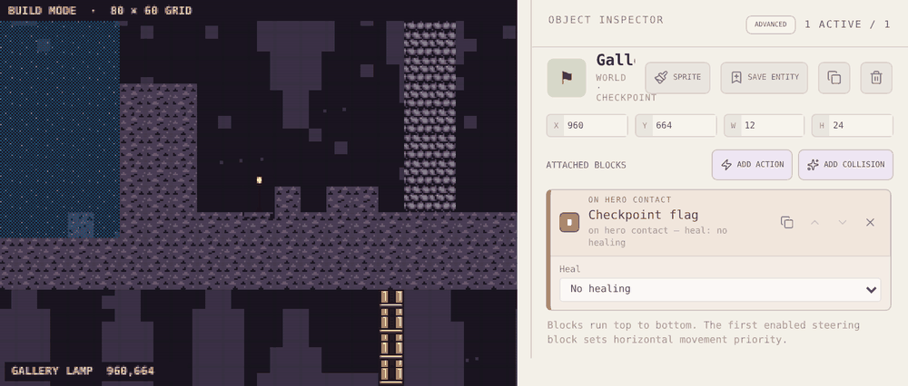

1. Copy **Hall lamp**: **Gallery lamp** at `960, 664`.

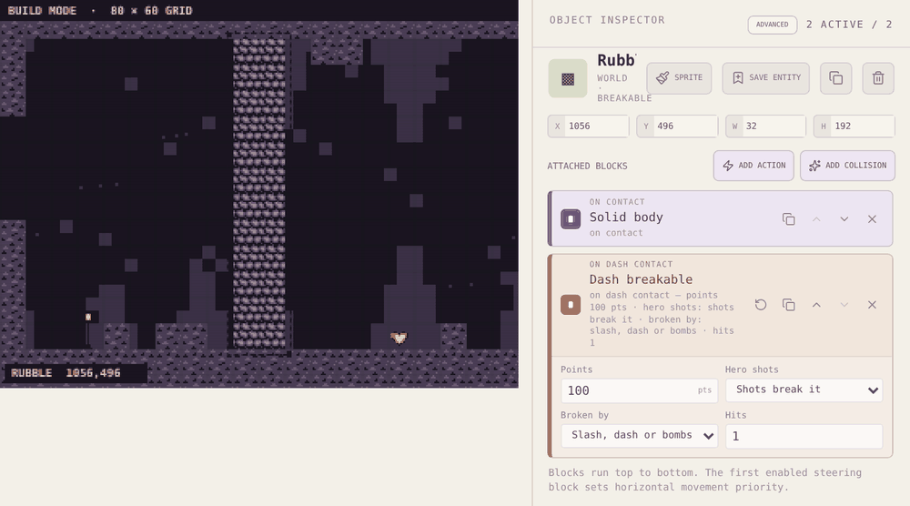

2. Place a **Cracked wall**. Name **Rubble**, at `1056, 496, 32 × 192`.
3. Keep **Solid body**. In the **Dash breakable** card set `Points = 100` and `Hero shots = Shots break it`. Only the cutter (hero shots) can reach it, because Tam cannot dash.
4. **SPRITE** > import `rubble/idle.png`, **ON BIG OBJECTS = Repeat as tiles** > **SAVE SPRITE**.

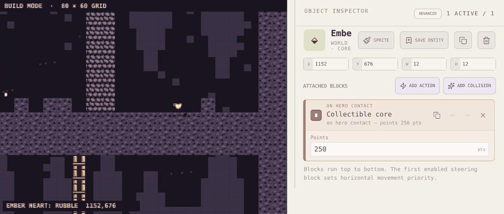

5. Copy an Ember heart: **Ember heart: rubble** at `1152, 676`.

> **Check:** with the cutter on, fire F at the rubble. It breaks and the heart is yours.

---

### Part 10: The deep caves (heart 4)

#### 10.1 Fungus grotto: bait

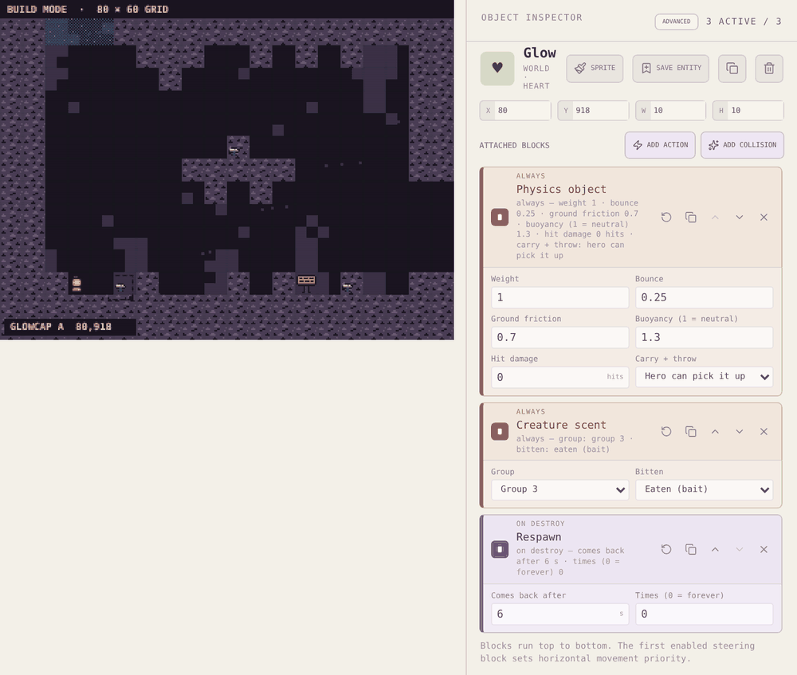

1. Place a **Heart**. Name **Glowcap A**, at `80, 918, 10 × 10`.
2. **×** on **Healing heart**.
3. **ADD COLLISION** > **Physics object**: `Weight = 1`, `Bounce = 0.25`, `Ground friction = 0.7`, `Buoyancy (1 = neutral) = 1.3`, `Hit damage = 0`, `Carry + throw = Hero can pick it up`. It floats, so it survives the swim back up.
4. **ADD COLLISION** > search "Scent" > **Creature scent**: `Group = Group 3`, `Bitten = Eaten (bait)`.
5. **ADD ACTION** > **Respawn**: `Comes back after = 6`, `Times (0 = forever) = 0`. The player can always fetch another.
6. **SPRITE** > import `glowcap-a/idle.png` > **SAVE SPRITE**.
7. **Ctrl+D**: **Glowcap B** at `160, 822`, then **Glowcap C** at `240, 918`.

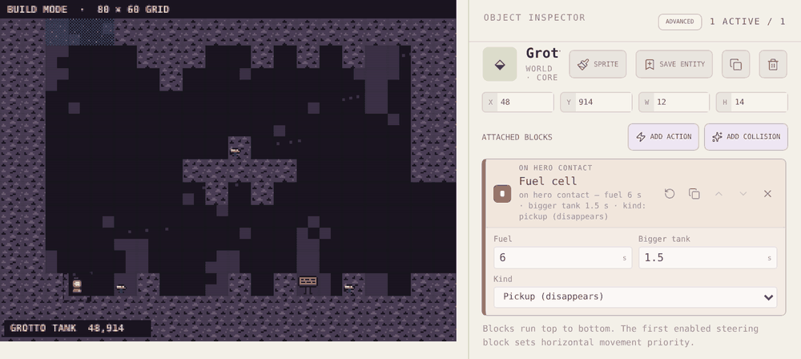

8. Copy **Big tank**: **Grotto tank** at `48, 914`, and set its Fuel cell `Bigger tank = 1.5`.

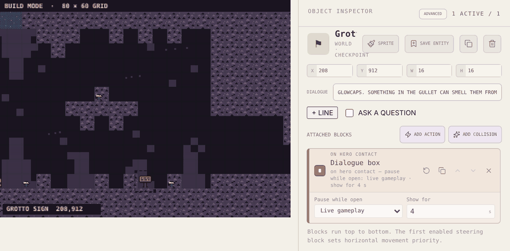

9. Copy a sign: **Grotto sign** at `208, 912`: `GLOWCAPS. SOMETHING IN THE GULLET CAN SMELL THEM FROM HERE.`

#### 10.2 Gnasher's gullet: the guardian

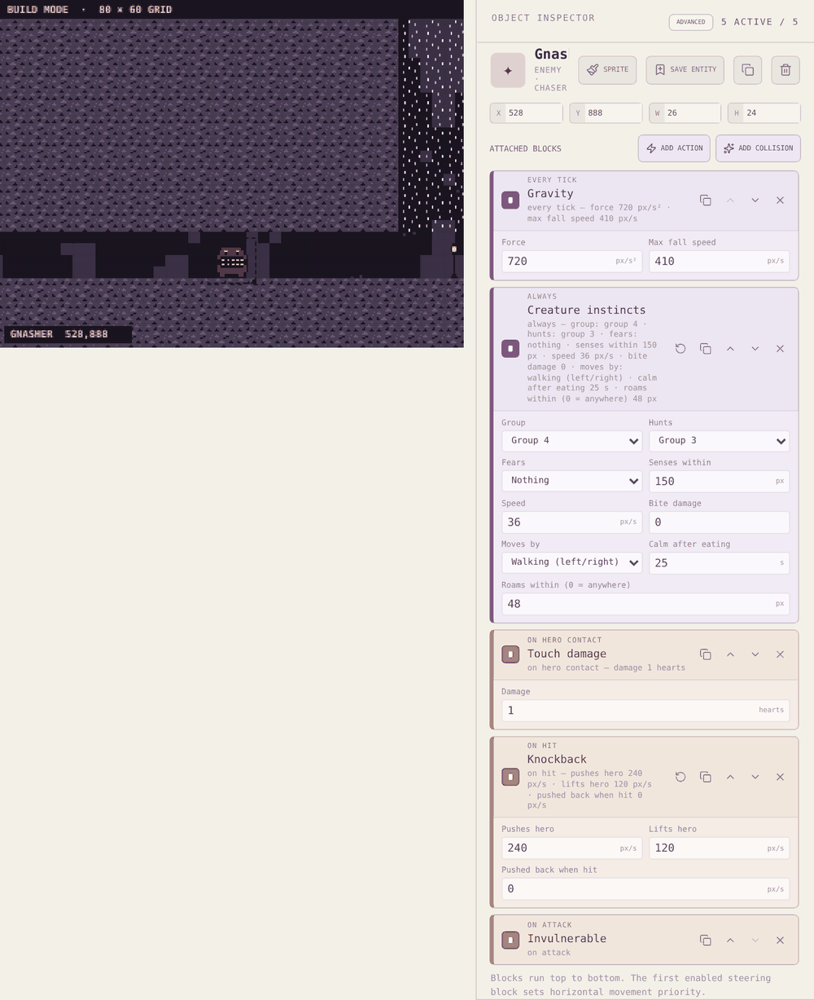

1. Place a **Prowler**. Name **Gnasher**, at `528, 888, 26 × 24`.
2. Keep **Gravity** and **Touch damage** (`Damage = 1`). Click **×** on **Chase** and **Stompable**.
3. **ADD ACTION** > **Creature instincts**:

   | Setting                     | Value                |
   | --------------------------- | -------------------- |
   | Group                       | Group 4              |
   | Hunts                       | Group 3              |
   | Fears                       | Nothing              |
   | Senses within               | 150                  |
   | Speed                       | 36                   |
   | Bite damage                 | 0                    |
   | Moves by                    | Walking (left/right) |
   | Calm after eating           | 25                   |
   | Roams within (0 = anywhere) | 48                   |

4. **ADD COLLISION** > search "Knock" > **Knockback**: `Pushes hero = 240`, `Lifts hero = 120`, `Pushed back when hit = 0`.
5. **ADD COLLISION** > search "Invul" > **Invulnerable**. It has no settings. The Gnasher cannot be beaten.
6. **SPRITE** > import `gnasher/idle.png`; **+ STATE** `move`, import `gnasher/move.png`, **FRAME TIME = 0.25**; **+ STATE** `calm`, import `gnasher/calm.png` (sleepy), **FRAME TIME = 0.25** > **SAVE SPRITE**. Creature instincts plays `calm` by itself after it eats.

Throw it a glowcap: it eats, turns calm for 25 seconds and stops hurting.

#### 10.3 Bell chamber: the impact switch

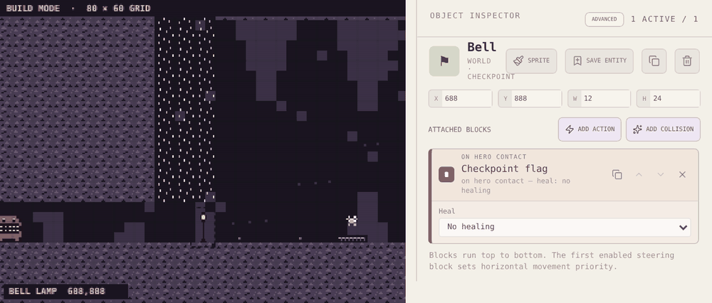

1. Copy **Hall lamp**: **Bell lamp** at `688, 888`.


2. Copy **Hall vent**: **Bell vent** at `800, 888`.


3. Place a **Core**. Name **Pebble A**, at `720, 906, 6 × 6`. **×** on **Collectible core**.
4. **ADD COLLISION** > **Physics object**: `Weight = 1`, `Bounce = 0.45`, `Ground friction = 0.25`, `Buoyancy (1 = neutral) = 0.6`, `Hit damage = 1`, `Carry + throw = Hero can pick it up`.
5. **SPRITE** > import `pebble-a/idle.png` > **SAVE SPRITE**.
6. **Ctrl+D**: **Pebble B** at `768, 906`, **Pebble C** at `864, 906`.


7. Copy **Rock 1** (it has the rock sprite): name **Mousehole lip**, at `944, 896, 16 × 5`. It leaves an 11 px gap above the floor: too low for Tam, wide open for a rolling pebble.


8. Place a **Brick**. Name **Old bell**, at `976, 864, 16 × 48`. Keep **Solid body**.
9. **ADD COLLISION** > search "Impact" > **Impact switch**: `Channel = 2`, `Min speed = 50`, `Each hit = Turns the channel on`. Tam touching it does nothing; only a thrown or rolled object moving faster than 50 px/s rings it.
10. **SPRITE** > import `old-bell/idle.png`; **+ STATE** `rung`, import `old-bell/rung.png` (two frames), **FRAME TIME = 0.15** > **SAVE SPRITE**. It plays `rung` when struck.


11. Copy **Sluice gate**: name **Brass gate**, at `1040, 736, 16 × 96`, and set its Switch door `Channel = 2`.


12. Copy an Ember heart: **Ember heart: vault** at `1184, 900`.


13. Copy a sign: **Bell sign** at `896, 896`, two lines:
    1. `THE OLD BELL OPENS THE BRASS GATE. ONLY A PEBBLE FITS THE HOLE.`
    2. `HOLD DOWN AS YOU THROW TO ROLL IT. THE GEYSER IN THE WEST CORNER TAKES YOU BACK UP.`

#### 10.4 The way back up


1. Copy **Chimney draught low**: name **Geyser**, at `656, 720, 48 × 160`, and set its Wind zone `Lift = 1100`.


2. Place a **Platform**. Name **Geyser lid**, at `656, 704, 48 × 6`. Keep **One-way top** and set `Drop through = Always solid on top`. Tam rises through it into the cistern and cannot fall back down.
3. Optional: give it the rock sprite (**SPRITE** > import `rock-1/idle.png`, **Repeat as tiles**).

> **Check:** carry a glowcap through the gullet and throw it near the Gnasher: it eats and dozes. Pick up a pebble, hold Down and press X beside the mousehole. The bell rings and the brass gate opens. The geyser lifts Tam back into the cistern.

---

### Part 11: Playtest the whole game

1. From the Furnace hall go west, open the toolbox (cutter on F).
2. East: ride the chimney draught to the first heart.
3. Down the central shaft to the cistern. Anvil stone onto the plate, heart 2.
4. Through the windpipe and rubble gallery: cut the rubble (F), heart 3.
5. Swim down the siphon to the grotto. Glowcap to the Gnasher, pebble through the mousehole, heart 4.
6. Geyser up, back to the Furnace lift. It opens once all four hearts are collected.

Save with **FILE > Save** when it works.

#### Troubleshooting

| Problem                          | Fix                                                                                                                                       |
| -------------------------------- | ----------------------------------------------------------------------------------------------------------------------------------------- |
| Tam cannot climb                 | Jetpack Thrust must be well above Gravity Force (1180 vs 720)                                                                             |
| Tam falls through floors         | Rock pieces need Solid body; check for gaps between pieces against Appendix A                                                             |
| Rock looks stretched             | Rock sprite **ON BIG OBJECTS** must be **Repeat as tiles**                                                                                |
| F does nothing after the toolbox | The toolbox rule must target **Tam** with IF `stateEquals` `open`, and turn **Hero shot** on                                              |
| The stone floats                 | Buoyancy 0.15 and Weight 9 on the anvil stone                                                                                             |
| The plate does not open the gate | Plate Required weight 3, same channel (1) as the gate's Switch door                                                                       |
| The Gnasher ignores glowcaps     | Glowcaps need Creature scent Group 3 and Bitten = Eaten (bait); the Gnasher must hunt Group 3                                             |
| The bell never rings             | The pebble must hit faster than Min speed 50; throw harder or roll it with Down + X                                                       |
| The lift never opens             | Every object with Collectible core counts: the gallery cell, big tanks, pebbles and the puffball must have their Collectible core removed |
| The marker shows in the game     | World settings needs the rule `WHEN onStart · TARGET self · DO Show / hide (hide)`                                                        |

---

### Ideas to take it further

- Add a **Time limit** for a speedrun mode.
- Put a **Swoop** on a new cave flyer that dives at Tam from the ceiling.
- Hide a second **Bigger tank** behind a **Blink** wall.
- Add a **Follower** lantern-moth that trails Tam and carries **Healing aura**.

---

### Appendix A: rock pieces

Every piece is a copy of **Rock 1** (Brick, Solid body, rock sprite repeated as tiles). Type the name, then X, Y, W and H.

| Name     | x    | y   | w   | h   |
| -------- | ---- | --- | --- | --- |
| Rock 1   | 0    | 0   | 320 | 48  |
| Rock 2   | 320  | 0   | 320 | 32  |
| Rock 3   | 640  | 0   | 320 | 32  |
| Rock 4   | 960  | 0   | 320 | 48  |
| Rock 5   | 320  | 32  | 80  | 16  |
| Rock 6   | 416  | 32  | 16  | 16  |
| Rock 7   | 560  | 32  | 192 | 16  |
| Rock 8   | 864  | 32  | 16  | 32  |
| Rock 9   | 944  | 32  | 16  | 240 |
| Rock 10  | 0    | 48  | 32  | 240 |
| Rock 11  | 48   | 48  | 48  | 16  |
| Rock 12  | 176  | 48  | 16  | 16  |
| Rock 13  | 240  | 48  | 112 | 16  |
| Rock 14  | 368  | 48  | 32  | 16  |
| Rock 15  | 592  | 48  | 16  | 16  |
| Rock 16  | 624  | 48  | 96  | 16  |
| Rock 17  | 736  | 48  | 16  | 16  |
| Rock 18  | 960  | 48  | 64  | 224 |
| Rock 19  | 1232 | 48  | 48  | 240 |
| Rock 20  | 64   | 64  | 16  | 16  |
| Rock 21  | 240  | 64  | 96  | 16  |
| Rock 22  | 256  | 80  | 80  | 48  |
| Rock 23  | 96   | 96  | 64  | 16  |
| Rock 24  | 784  | 96  | 80  | 16  |
| Rock 25  | 1088 | 96  | 144 | 224 |
| Rock 26  | 112  | 112 | 16  | 16  |
| Rock 27  | 800  | 112 | 32  | 16  |
| Rock 28  | 848  | 112 | 16  | 16  |
| Rock 29  | 624  | 128 | 96  | 144 |
| Rock 30  | 736  | 128 | 16  | 176 |
| Rock 31  | 720  | 144 | 16  | 128 |
| Rock 32  | 752  | 144 | 16  | 160 |
| Rock 33  | 608  | 176 | 16  | 112 |
| Rock 34  | 96   | 192 | 320 | 64  |
| Rock 35  | 416  | 192 | 48  | 192 |
| Rock 36  | 512  | 192 | 96  | 96  |
| Rock 37  | 768  | 208 | 32  | 64  |
| Rock 38  | 848  | 208 | 96  | 64  |
| Rock 39  | 128  | 256 | 64  | 16  |
| Rock 40  | 224  | 256 | 16  | 16  |
| Rock 41  | 304  | 256 | 112 | 128 |
| Rock 42  | 144  | 272 | 16  | 16  |
| Rock 43  | 176  | 272 | 16  | 16  |
| Rock 44  | 624  | 272 | 32  | 16  |
| Rock 45  | 672  | 272 | 16  | 16  |
| Rock 46  | 880  | 272 | 16  | 32  |
| Rock 47  | 1008 | 272 | 16  | 48  |
| Rock 48  | 0    | 288 | 32  | 240 |
| Rock 49  | 1232 | 288 | 48  | 32  |
| Rock 50  | 160  | 320 | 16  | 32  |
| Rock 51  | 1136 | 320 | 48  | 16  |
| Rock 52  | 1200 | 320 | 32  | 32  |
| Rock 53  | 1248 | 320 | 32  | 240 |
| Rock 54  | 144  | 336 | 16  | 16  |
| Rock 55  | 176  | 336 | 64  | 16  |
| Rock 56  | 512  | 336 | 144 | 160 |
| Rock 57  | 736  | 336 | 16  | 32  |
| Rock 58  | 784  | 336 | 16  | 32  |
| Rock 59  | 1152 | 336 | 32  | 16  |
| Rock 60  | 176  | 352 | 16  | 16  |
| Rock 61  | 752  | 352 | 32  | 16  |
| Rock 62  | 800  | 352 | 16  | 32  |
| Rock 63  | 32   | 368 | 32  | 32  |
| Rock 64  | 752  | 368 | 16  | 32  |
| Rock 65  | 64   | 384 | 32  | 16  |
| Rock 66  | 96   | 432 | 16  | 64  |
| Rock 67  | 208  | 432 | 16  | 64  |
| Rock 68  | 832  | 432 | 32  | 64  |
| Rock 69  | 1120 | 432 | 32  | 64  |
| Rock 70  | 32   | 448 | 64  | 48  |
| Rock 71  | 112  | 448 | 96  | 48  |
| Rock 72  | 224  | 448 | 240 | 48  |
| Rock 73  | 656  | 448 | 176 | 48  |
| Rock 74  | 864  | 448 | 256 | 48  |
| Rock 75  | 1152 | 448 | 96  | 48  |
| Rock 76  | 160  | 496 | 16  | 16  |
| Rock 77  | 240  | 496 | 16  | 16  |
| Rock 78  | 720  | 496 | 32  | 16  |
| Rock 79  | 768  | 496 | 16  | 16  |
| Rock 80  | 848  | 496 | 16  | 32  |
| Rock 81  | 880  | 496 | 48  | 48  |
| Rock 82  | 1056 | 496 | 32  | 32  |
| Rock 83  | 1104 | 496 | 32  | 16  |
| Rock 84  | 720  | 512 | 16  | 16  |
| Rock 85  | 0    | 528 | 32  | 240 |
| Rock 86  | 320  | 528 | 64  | 240 |
| Rock 87  | 576  | 544 | 48  | 240 |
| Rock 88  | 32   | 560 | 112 | 16  |
| Rock 89  | 1248 | 560 | 32  | 240 |
| Rock 90  | 880  | 608 | 48  | 128 |
| Rock 91  | 976  | 672 | 16  | 64  |
| Rock 92  | 1008 | 672 | 32  | 64  |
| Rock 93  | 1056 | 672 | 16  | 64  |
| Rock 94  | 1184 | 672 | 16  | 64  |
| Rock 95  | 848  | 688 | 16  | 48  |
| Rock 96  | 928  | 688 | 48  | 48  |
| Rock 97  | 992  | 688 | 16  | 48  |
| Rock 98  | 1040 | 688 | 16  | 48  |
| Rock 99  | 1072 | 688 | 112 | 48  |
| Rock 100 | 1200 | 688 | 48  | 48  |
| Rock 101 | 80   | 704 | 240 | 48  |
| Rock 102 | 384  | 704 | 192 | 176 |
| Rock 103 | 624  | 704 | 32  | 176 |
| Rock 104 | 704  | 704 | 144 | 32  |
| Rock 105 | 864  | 704 | 16  | 32  |
| Rock 106 | 96   | 752 | 48  | 16  |
| Rock 107 | 176  | 752 | 16  | 16  |
| Rock 108 | 208  | 752 | 16  | 16  |
| Rock 109 | 240  | 752 | 16  | 16  |
| Rock 110 | 288  | 752 | 32  | 96  |
| Rock 111 | 0    | 768 | 32  | 192 |
| Rock 112 | 112  | 768 | 16  | 16  |
| Rock 113 | 320  | 768 | 64  | 80  |
| Rock 114 | 576  | 784 | 48  | 96  |
| Rock 115 | 1248 | 800 | 32  | 160 |
| Rock 116 | 160  | 816 | 16  | 32  |
| Rock 117 | 128  | 832 | 32  | 16  |
| Rock 118 | 176  | 832 | 32  | 16  |
| Rock 119 | 944  | 832 | 112 | 32  |
| Rock 120 | 144  | 848 | 16  | 16  |
| Rock 121 | 176  | 848 | 16  | 16  |
| Rock 122 | 368  | 848 | 16  | 32  |
| Rock 123 | 944  | 864 | 16  | 32  |
| Rock 124 | 992  | 864 | 64  | 96  |
| Rock 125 | 32   | 912 | 16  | 48  |
| Rock 126 | 96   | 912 | 16  | 48  |
| Rock 127 | 160  | 912 | 16  | 48  |
| Rock 128 | 192  | 912 | 16  | 48  |
| Rock 129 | 240  | 912 | 16  | 48  |
| Rock 130 | 288  | 912 | 320 | 48  |
| Rock 131 | 608  | 912 | 320 | 48  |
| Rock 132 | 928  | 912 | 64  | 48  |
| Rock 133 | 1056 | 912 | 192 | 48  |
| Rock 134 | 48   | 928 | 48  | 32  |
| Rock 135 | 112  | 928 | 48  | 32  |
| Rock 136 | 176  | 928 | 16  | 32  |
| Rock 137 | 208  | 928 | 32  | 32  |
| Rock 138 | 256  | 928 | 32  | 32  |

